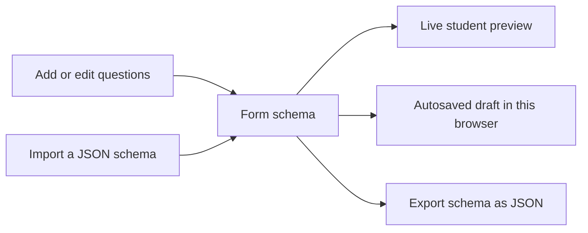

# Form Studio

**Build a form and see the student view change as you work.** Form Studio is a small, no-code form builder made with plain HTML, CSS, and JavaScript. You can open it in a browser without installing packages.

**Try it:** [form-studio.onrender.com](https://form-studio.onrender.com)

## How it works

The questions you create are kept in one form schema. The builder and the student preview both read that schema, so a change in the builder appears in the preview right away.



## Get started

### Use the live version

Open [Form Studio](https://form-studio.onrender.com). Your draft is saved in the browser you are using, so it will not automatically appear on another device or browser.

### Run it on your computer

1. Open the project folder.
2. Open `index.html` in a modern web browser.
3. Start adding questions. No build command or package installation is needed.

## Build a form

1. Give the form a name and an optional welcome message.
2. Choose a question type to add it.
3. Select a question in **Question order** to edit its label, help text, answer choices, and required setting.
4. Use the arrow buttons to move a question up or down, or the remove button to delete it.
5. Check the **Live preview** as you go. Switch between desktop and mobile views, and try filling in the form.
6. Use **Export JSON** to download your form, or **Import JSON** to load one. The included [`example-schema.json`](example-schema.json) is a sample you can import.

## Included features

| Feature | What it does |
| --- | --- |
| Six question types | Short answer, number, dropdown, checkbox, date, and file picker |
| Form editing | Add, edit, reorder, and remove questions |
| Required questions | Choose which answers are required |
| Live preview | See the student-facing form update as you edit; preview it at desktop or mobile width |
| Answer rules | Set minimum or maximum text length and number range |
| Conditional questions | Show a question based on an answer to an earlier question |
| Undo and redo | Use the toolbar or `Ctrl/⌘ + Z` and `Ctrl/⌘ + Shift + Z` |
| Draft autosave | Keep the current form in this browser's local storage |
| JSON import and export | Move form schemas in or out of the builder |
| Schema version | Include a version number in every exported schema |

The interface uses standard buttons and inputs, visible labels, and a skip link for keyboard users. This is a basic accessibility foundation, not a full accessibility audit.

## How the form is stored

`app.js` keeps the form definition in a JavaScript object called `schema`. It contains the form name, welcome message, and ordered list of questions. Editing a question updates that object; then the question list and student preview are rendered from it.

Preview answers are held separately from the schema. This keeps a student's test answers out of the form definition. When the form changes, Form Studio saves the schema to the browser's local storage. Undo and redo use snapshots of the schema. Import checks and normalizes a JSON file before loading it; export downloads the current schema as JSON.

## Example schema

The included [`example-schema.json`](example-schema.json) shows the complete format. A small part looks like this:

```json
{
  "schemaVersion": 1,
  "settings": {
    "title": "Student Workshop Registration",
    "description": "Choose a session and tell us what you would like to learn."
  },
  "fields": [
    {
      "id": "full-name",
      "type": "text",
      "label": "Your name",
      "required": true,
      "options": [],
      "validation": {},
      "condition": null
    }
  ]
}
```

Each question has a unique `id`, a `type`, a label, and settings for options, validation, and conditions. The full sample includes all six question types and an example conditional question.

## Project files

- `index.html` — page structure and controls
- `styles.css` — layout and visual styling
- `app.js` — form editing, preview, validation, history, and JSON handling
- `example-schema.json` — sample form to import

## A note about the preview

This project is a front-end form builder. Submitting the preview only checks the answers in the browser; it does not send or save responses. Choosing a file shows its name, but does not upload the file anywhere. Draft autosave stores the **form design** in the current browser, not student responses.
